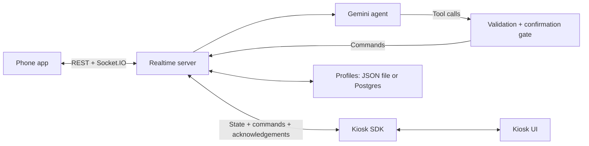

# AllScreen — Kiosk Access

AllScreen lets a blind or low-vision customer use a touchscreen kiosk from their own
phone. Scan a QR code or enter the kiosk's fixed code, speak or type to the assistant,
and watch the kiosk carry out actions on its actual UI. The phone reads back the
order or check-in details and asks for confirmation before payment or submission.

The repo includes a phone app, four mock kiosks, a Gemini agent, a command bridge,
realtime pairing and sessions, saved customer profiles, and a kiosk integration SDK.
Payments, appointments, movie listings, and transit fares are simulated demo data.

Demo URLs: [kiosk](https://kiosk-access-kiosk.onrender.com/) ·
[phone](https://www.allscreen.work/)

## Run locally

Use Node **22.12.0** (see [.node-version](.node-version)) and pnpm **10.28.0**.
Run commands from the repository root. `corepack pnpm` uses the pinned pnpm version
without requiring a global pnpm installation.

Install dependencies and copy the example environment file if you do not already
have a root `.env`:

```bash
corepack pnpm install --frozen-lockfile
cp -n .env.example .env
```

The server scripts and both Vite apps read this root file.

Start each app in a separate terminal:

```bash
corepack pnpm dev:server   # API + Socket.IO: http://localhost:3001
corepack pnpm dev:kiosk    # kiosk UI:       http://localhost:5173
corepack pnpm dev:phone    # phone UI:       http://localhost:5174
```

Open the kiosk in one browser window and the phone app in another. Enter the code
shown below the kiosk's QR code into the phone app, then tap the start button.
Only one accessible session can use a kiosk at a time.

**The default `AGENT_MODE=stub` only echoes messages and reports the current screen.**
It is useful for testing pairing and transport; it does not turn requests into kiosk
actions. Enable Gemini for conversational ordering, tickets, or check-in.

### Enable the assistant

Edit the root `.env`:

```dotenv
AGENT_MODE=gemini
GEMINI_API_KEY=your-api-key
GEMINI_MODEL=your-model-id
# Optional: a second model to try if the primary keeps failing
GEMINI_FALLBACK_MODEL=your-fallback-model-id
```

Use model IDs available to your Google AI Studio project; [.env.example](.env.example)
contains the repository's configured examples. Omit or clear `GEMINI_FALLBACK_MODEL`
if you do not want a fallback. `LLM_API_KEY` is supported as a legacy fallback for
`GEMINI_API_KEY`. Provider keys belong only on the server, never in `VITE_` variables.
Restart the server after changing its environment.

With Gemini enabled, try “A Box Combo with lemonade, no coleslaw,” then “That's it.”
After reviewing the order, tap **Confirm order** or say **I confirm**. On the kiosk's
payment screen, click **Tap card here** or press **c** in the kiosk window to simulate
a card payment. The phone announces the resulting confirmation number.

### Use a physical phone

Camera and microphone features need a secure context. Localhost works for desktop
development; a phone connecting to your laptop needs an HTTPS setup. Expose both the
phone app on port `5174` and the API/Socket.IO server on port `3001` through HTTPS
tunnels, or use hosted instances of both.

For example, with your own public URLs:

```dotenv
PHONE_APP_URL=https://phone.example.com
VITE_SERVER_URL=https://api.example.com
CORS_ORIGINS=http://localhost:5173,http://localhost:5174,https://phone.example.com
VITE_PHONE_APP_HOST=phone.example.com
```

Replace the example hosts with your tunnel or deployment addresses. Include the
kiosk origin in `CORS_ORIGINS` too if it is hosted elsewhere. Restart the server and
Vite apps after changing URLs. `PHONE_APP_URL` determines the QR link;
`VITE_SERVER_URL` determines where both browser apps connect. `localhost` in a phone
browser refers to the phone itself.

## Four kiosk demos

One kiosk build serves all four venues. Use the kiosk's navigation menu or these URLs:

| Kiosk URL | Demo | Kiosk ID | Flow |
| --- | --- | --- | --- |
| `/` | Raising Cane's | `store42-kiosk1`, configurable with `VITE_KIOSK_ID` | Menu, customizations, cart, payment |
| `/?kind=clinic` | Seattle Children's Hospital | `clinic-kiosk1` | Name and date of birth, appointment, questions, review, check-in |
| `/?kind=cinema` | AMC Theaters | `cinema-kiosk1` | Movie, showtime, ticket quantities, seats, payment |
| `/?kind=transit` | Light Rail | `transit-kiosk1` | Origin, destination, ticket and fare type, quantity, payment |

Each kiosk must be open and connected before a phone can pair with it. Keep different
kinds in separate windows to demonstrate them simultaneously. Two windows registering
the same kiosk ID replace each other's server connection.

Food ordering uses the shared [menu.json](packages/shared/menu.json), including
required drink choices, optional removals, prices, tax, and a hidden combo upgrade
offered through a popup. The clinic, cinema, and transit demos publish their visible
buttons, text fields, and information. The agent drives them with `press_button` and
`type_text`; those tools and their bridge handlers are already implemented.

## How it works



1. The kiosk registers with its ID and shared key. The server issues rotating QR
   links, and the kiosk also displays a fixed code derived from its ID.
2. The phone creates a session using either the QR token or the fixed code, then
   authenticates its socket with the returned session ID and secret.
3. Typed messages and voice transcripts reach the agent. It receives current kiosk
   state, recent conversation history, and any attached profile memory.
4. The bridge validates tool calls and waits for kiosk acknowledgements. The SDK
   executes commands sequentially; the browser kiosk animates taps on real DOM
   controls and publishes updated state.
5. `request_checkout` opens a review. The bridge handles confirmation in code,
   then starts payment or submits a clinic check-in. The phone receives the final
   kiosk state and announces the actual order, ticket, or queue number.

### Confirmation behavior

The model has no `start_payment` tool. Direct tool presses on Pay, the card reader,
and Complete check-in are rejected. Confirmation comes from the phone's
`user:confirm` event or a whole-message affirmative such as “yes” or “I confirm”
while a review is pending. “Yes, but change the drink” clears the pending review
and goes back to the agent.

The gate snapshots cart items, quantities, options, fields, and information lines,
and checks them again before submission. Changes to those details require a new
review. Cart comparison does not compare prices; the current kiosk total remains
the amount used for payment. Food upsells stop the command flow until the customer
chooses a popup response.

### Voice and saved profiles

The phone supports typed chat, spoken replies, a hands-free speak/listen loop,
repeat-last-message, order review, and speaking-speed settings. Recognition uses
the browser's speech API when available. If it is missing or fails, the phone can
record a short WAV clip and send it to `/api/transcribe`, where the server uses
Gemini. This fallback requires a valid session plus Gemini key/model configuration,
even if `AGENT_MODE=stub`. Text input remains available when voice cannot run.

A profile is created automatically when the phone first attaches to an ordering
session. Its bearer token is kept in that browser's local storage; preferences and
completed orders are stored on the server. The app can remember a name, speaking
speed, vegetarian/vegan preferences, and allergies, and offer the last food order
at the same location. The menu has no allergen data, so saved allergies are reminders,
not a guarantee that an item is safe.

The phone's `/profile` page and in-session Memory/Settings panels show saved data.
Profiles retain up to three completed orders per location. Clinic check-ins have
an empty cart and are not saved as orders. “Forget me” or the profile deletion UI
removes the profile and its order history; the separate event log is not deleted.

## Repository map

| Path | Responsibility |
| --- | --- |
| [apps/phone/src](apps/phone/src) | React/Vite phone app, QR/code entry, chat, speech, confirmation, profiles |
| [apps/kiosk/src](apps/kiosk/src) | React/Vite kiosk UI, Zustand stores, animated command execution |
| [apps/kiosk/src/kiosks](apps/kiosk/src/kiosks) | Clinic, cinema, and transit demos |
| [apps/server/src/realtime](apps/server/src/realtime) | Socket.IO, pairing, session lifecycle, state relay, event log |
| [apps/server/src/bridge](apps/server/src/bridge) | Menu/input validation, command acknowledgements, confirmation gate |
| [apps/server/src/agent](apps/server/src/agent) | Gemini adapter, retries/fallback model, tools, prompts, history, evaluation fixtures |
| [apps/server/src/profiles](apps/server/src/profiles) | Profile API, preferences, order memory, file/Postgres persistence |
| [apps/server/src/transcribe.ts](apps/server/src/transcribe.ts) | Session-authenticated Gemini audio transcription |
| [apps/server/scripts](apps/server/scripts) | Smoke checks, terminal phone, agent checks and evaluations |
| [packages/kiosk-sdk](packages/kiosk-sdk) | `AccessKiosk` SDK and headless fake food kiosk |
| [packages/shared](packages/shared) | State/command/socket contracts, kiosk codes, menu, fixtures |
| [apps/menu_images](apps/menu_images) | Source image assets; app assets also live under each app's `src/assets` |
| [render.yaml](render.yaml) | Server, phone, kiosk, and Postgres deployment blueprint |

There is no dashboard app in this repository. Event data is available through
`GET /api/events`.

## Configuration

These are runtime defaults unless stated otherwise. Additional variables can be
added to the root `.env` even if they are not listed in `.env.example`.

| Variable | Default / purpose |
| --- | --- |
| `PORT` | `3001`; API and Socket.IO port |
| `KIOSK_KEY` | `dev-kiosk-key`; kiosk registration key |
| `PHONE_APP_URL` | `http://localhost:5174`; base URL for QR links |
| `CORS_ORIGINS` | Comma-separated origins; unset or `*` reflects any origin. `.env.example` sets local origins. |
| `AGENT_MODE` | `stub`; set `gemini` for the live assistant |
| `GEMINI_API_KEY` / `LLM_API_KEY` | Server-side Gemini key; the former takes precedence |
| `GEMINI_MODEL` | Required for Gemini; no code default |
| `GEMINI_FALLBACK_MODEL` | Optional model used after primary model failures |
| `DEV_ROUTES` | Off unless `1`; `.env.example` and the Render blueprint enable it |
| `EVENTS_FILE` | `events.jsonl`; append-only event log |
| `PROFILES_FILE` | `profiles.json`; profile storage when `DATABASE_URL` is unset |
| `DATABASE_URL` | Optional PostgreSQL connection string; the profiles table is created automatically |
| `DATABASE_SSL` | `1` enables the implementation's SSL mode (`rejectUnauthorized: false`) |
| `BRIDGE_COMMAND_TIMEOUT_MS` | `10000`; acknowledgement timeout once a command reaches the front of its kiosk queue |
| `TRANSCRIBE_STUB` | Optional fixed transcript for local testing; requires `DEV_ROUTES=1` |
| `VITE_SERVER_URL` | `http://localhost:3001`; API/Socket.IO URL for both browser apps |
| `VITE_KIOSK_ID` | `store42-kiosk1`; food kiosk ID |
| `VITE_KIOSK_KEY` | `dev-kiosk-key`; must match the server's `KIOSK_KEY` |
| `VITE_PHONE_APP_HOST` | `allscreen.work`; display text next to the kiosk code, independent of the QR URL |

Relative storage paths resolve from the server process's working directory
(`apps/server` when using the supplied pnpm scripts). PostgreSQL persists profiles;
active sessions, kiosk connections, pending confirmations, and agent history remain
in memory and are lost on server restart. The current server is designed to run as
a single instance.

### Session and kiosk timers

All values below are milliseconds. Fixed kiosk codes do not rotate or expire;
the first two settings apply only to QR tokens.

| Variable | Default | Behavior |
| --- | --- | --- |
| `CODE_ROTATE_MS` | `60000` | Issue a new QR token every minute |
| `CODE_TTL_MS` | `90000` | Each QR token is valid for 90 seconds; starting a session invalidates all current tokens |
| `SESSION_IDLE_MS` | `180000` | End an inactive accessible session after three minutes |
| `PHONE_GRACE_MS` | `30000` | Allow 30 seconds for the phone to connect or reconnect |
| `KIOSK_GRACE_MS` | `15000` | Allow 15 seconds for kiosk reconnection |
| `END_AFTER_COMPLETE_MS` | `20000` | End a session 20 seconds after completion |
| `VITE_IDLE_MS` | `90000` | Food kiosk's “Still there?” delay when no accessible session is active |
| `VITE_STILL_THERE_MS` | `20000` | Reset an unanswered food-kiosk inactivity popup after 20 seconds |

## Checks and developer tools

The unit suites and default agent evaluation run without Gemini credentials:

```bash
corepack pnpm typecheck
corepack pnpm test:agent
corepack pnpm test:bridge
corepack pnpm test:sdk
corepack pnpm test:profiles
corepack pnpm agent:eval
```

Agent tests include browser-speech lifecycle tests using fake browser APIs. Bridge
tests cover validation, generic kiosks, checkout, and command/event handling. SDK
tests use local sockets and a fake kiosk. Profile tests cover JSON persistence and
Postgres behavior via `pg-mem`; no external database is needed.

The evaluation runner replays scripted conversation contracts against a simulated
bridge. It supports `--list`, `--case checkout`, `--runs 5`, and
`--output /tmp/kiosk-agent-report.json` (the output path must not already exist).
Some scripted wording still references an older menu; use
`packages/shared/menu.json` for current items and prices. Offline passes do not
measure live model accuracy or real-phone speech quality.

Build the browser apps:

```bash
corepack pnpm --filter @kiosk-access/kiosk build
corepack pnpm --filter @kiosk-access/phone build
```

For realtime smoke checks, start a server explicitly in stub mode, then run the
smoke command in another terminal. The script creates its own socket clients;
the kiosk and phone UIs are not required.

```bash
# Terminal 1
AGENT_MODE=stub DEV_ROUTES=1 corepack pnpm dev:server

# Terminal 2
corepack pnpm smoke
```

For terminal-only food ordering, keep the server running with `DEV_ROUTES=1` and
start these in separate terminals:

```bash
corepack pnpm fake-kiosk terminal-kiosk1
corepack pnpm fake-phone terminal-kiosk1
```

Use Gemini mode on that server to turn terminal messages into actions. The fake
kiosk automatically simulates the card tap after payment starts. The fake phone
accepts `/yes`, `/no`, `/ping`, and `/end`. It can also connect to a browser kiosk:
`corepack pnpm fake-phone clinic-kiosk1`, for example. `SERVER_URL` overrides the
server address used by these scripts and smoke checks; `FAKE_COMMAND_MS` changes
the fake kiosk's per-command delay (default `600`).

These commands explicitly make live, potentially billable Gemini calls, regardless
of `AGENT_MODE`:

```bash
corepack pnpm agent:check "What combos do you have?"  # one read-only model call
corepack pnpm agent:eval --live                      # simulated bridge, live model
```

### API and integration reference

| Endpoint | Purpose |
| --- | --- |
| `GET /health` | Server health and online kiosk count |
| `POST /api/sessions` | Pair with `{ kioskId, token }` or `{ code }`; returns `{ sessionId, sessionSecret, kioskId }` |
| `GET /api/events?since=<ISO timestamp>` | Read logged events, optionally after a timestamp |
| `POST /api/profiles` | Create a profile and return its bearer token |
| `GET`, `PATCH`, `DELETE /api/profiles/me` | Read, update, or delete the bearer-authenticated profile |
| `POST /api/profiles/attach` | Attach a profile using its bearer token plus `{ sessionId, sessionSecret }` |
| `POST /api/transcribe` | Transcribe raw audio with `x-session-id` and `x-session-secret` headers |
| `GET /api/transcribe/status` | Inspect transcription configuration and recent success/error status |

Pairing failures include `404 code_not_found`, `409 kiosk_busy`, `410 code_expired`,
`429 too_many_attempts`, and `503 kiosk_offline`. Fixed codes have a kind prefix
(`FD`, `CN`, `TR`, or `HP`) and five digits; they are derived in
[codes.ts](packages/shared/src/codes.ts).

The phone's QR route is `/k/:kioskId?t=<token>`; manual codes use `/c/:code`.
Its Socket.IO auth is `{ role: "phone", sessionId, sessionSecret }`. It sends
`user:message`, `user:confirm`, and `user:end-session`, and receives `kiosk:state`,
`agent:message`, `session:started`, and `session:ended`. See the
[shared types](packages/shared/src/types.ts) for the complete contract and the
[SDK implementation](packages/kiosk-sdk/src/index.ts) for `AccessKiosk.connect`,
`onPairingCode`, `onSession`, `publishState`, and `onCommand`.

With `DEV_ROUTES=1`, `/api/dev/kiosks` lists connected kiosks,
`/api/dev/pairing/:kioskId` returns the current QR token/link, and
`POST /api/dev/command/:kioskId` sends a command directly and returns its acknowledgement:

```bash
curl -X POST http://localhost:3001/api/dev/command/store42-kiosk1 \
  -H 'content-type: application/json' \
  -d '{"command":{"type":"add_item","itemId":"box_combo","qty":1,"options":{"drink":["lemonade"],"remove":["no_coleslaw"]}}}'
```

Dev commands bypass the agent and bridge confirmation gate. These routes and the
event feed have no application authentication; events include conversation text
and command data. They are demo/debug interfaces.

## Deploy to Render

[render.yaml](render.yaml) defines four resources:

- `kiosk-access-server`: Node server running TypeScript through `tsx`, with `/health`.
- `kiosk-access-phone`: static build from `apps/phone/dist`, with an SPA rewrite.
- `kiosk-access-kiosk`: static build from `apps/kiosk/dist`.
- `kiosk-access-db`: PostgreSQL for saved profiles and order memory.

Create a Render Blueprint from the repository, then configure the service values:

1. Set the server's `PHONE_APP_URL` to the phone site's HTTPS URL or custom domain,
   and provide its Gemini key and accessible model IDs. The blueprint selects
   `AGENT_MODE=gemini` and connects `DATABASE_URL` to the database.
2. Set `VITE_SERVER_URL` on **both** static sites to the server's HTTPS URL.
3. Copy the generated server `KIOSK_KEY` into the kiosk site's `VITE_KIOSK_KEY`.
   Set `VITE_PHONE_APP_HOST` if the displayed phone hostname differs from `allscreen.work`.
4. Set `CORS_ORIGINS` on the server to the kiosk and phone origins. The blueprint
   leaves it unset, so the code otherwise reflects any origin.
5. Set `DEV_ROUTES=0` when direct debug access is no longer needed; the checked-in
   blueprint currently enables it. Rebuild static sites after changing `VITE_`
   values, since Vite embeds them at build time.

Keep the phone site's `/*` → `/index.html` rewrite so QR links, code links, and
`/profile` load directly. PostgreSQL retains profiles across deployments; the event
log remains a local file unless you configure persistent storage. Browser kiosk
registration keys are included in the client build, so this demo's shared-key
registration is not a production device-authentication system.

## Troubleshooting

| Symptom | Check |
| --- | --- |
| Assistant only echoes messages | Set `AGENT_MODE=gemini`, supply key/model configuration, and restart the server. |
| Kiosk status is `rejected` | Make `VITE_KIOSK_KEY` match the server's `KIOSK_KEY`. |
| Phone cannot connect | Check `VITE_SERVER_URL`, allowed origins, kiosk online status, and whether another session is active. |
| QR link opens the wrong host | Update server `PHONE_APP_URL`; `VITE_PHONE_APP_HOST` changes only the printed label. |
| QR token expired or was already used | Scan a fresh code or use the fixed kiosk code from the phone home page. |
| Phone stays silent or cannot listen | Tap the start/microphone control, allow microphone access, and use HTTPS. Check `/api/transcribe/status` for fallback configuration; use text if needed. |
| Need speech diagnostics | Add `?debug` to a phone code URL, or `&debug` to a QR URL that already has `?t=...`. |
| Need a phone design preview | Open `http://localhost:5174/?demo`; this route is development-only and uses preview UI. |
| Build cannot resolve a declared dependency | Run `corepack pnpm install --frozen-lockfile` after pulling changes. |
